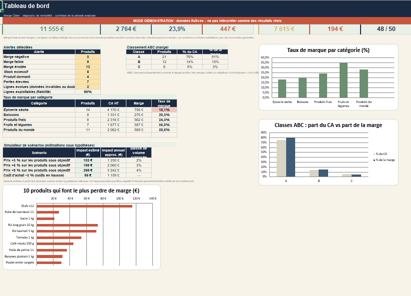
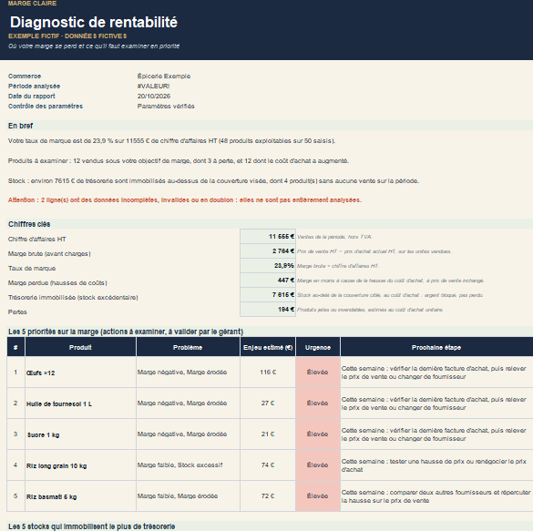

# Marge Claire : diagnostic de rentabilité pour commerces alimentaires

Classeur Excel (formules, sans macro) qui permet à un commerçant de voir où sa marge se perd,
à partir d'un simple export de ses ventes, achats et stocks.

## Problème traité
Dans un commerce alimentaire, la marge s'érode sans qu'on le voie : coûts d'achat qui montent,
produits vendus trop peu cher, stock qui dort, pertes. L'objectif est de repérer les produits
à traiter en priorité et de chiffrer l'enjeu.

## Ce que fait le classeur
- **Tableau de bord** : chiffre d'affaires HT, marge brute, taux de marque, marge perdue,
  trésorerie immobilisée, pertes, taux de lignes exploitables
- **Six alertes automatiques** : marge négative, marge faible, marge érodée (hausse du coût d'achat
  entre deux périodes), stock excessif, produit dormant, pertes élevées
- **Classement ABC** des produits selon leur contribution à la marge
- **Simulateur de scénarios** : hausses de prix de 3, 5 et 8 % avec hypothèse d'élasticité de la demande,
  et baisse négociée du coût d'achat
- **Feuille Priorités** : pour chaque produit, le problème détecté, le chiffre qui le prouve,
  l'action à examiner, l'enjeu estimé, l'urgence et la prochaine étape
- **Rapport client** prêt à exporter en PDF, avec plan d'action sur 30 jours
- **Contrôles d'import** : détection des données invalides et des doublons avant calcul

## Méthode
- Marge brute = prix de vente HT − prix d'achat HT ; taux de marque = marge ÷ prix de vente HT
- Comparaison de deux périodes consécutives de même durée
- Seuils d'alerte paramétrables (taux de marque minimum, érosion, pertes, stock)
- Formules Excel uniquement ; feuille de calculs masquée pour éviter les erreurs de manipulation
- Les enjeux et scénarios sont des **estimations**, pas des économies garanties

## Données
Le fichier de démonstration contient 50 lignes de produits **fictifs** (« Épicerie Exemple »)
réparties en 5 catégories : épicerie sèche, boissons, produits frais, fruits et légumes, produits du monde.
Deux lignes comportent volontairement une donnée manquante pour illustrer les contrôles d'import.

## Utilisation
1. Télécharger `Marge-Claire-Demo.xlsx`
2. L'ouvrir dans Excel et parcourir les feuilles *Tableau de bord* et *Priorités*
3. Pour tester d'autres données : renseigner *Paramètres*, puis coller les 11 colonnes dans *Données*

## Limites
- Version de démonstration, testée sur données fictives uniquement
- Seuils par défaut indicatifs, à valider avec le commerçant
- Capacité : 200 produits maximum
- Marge brute avant charges (hors loyer, personnel, énergie)

## Outils
Excel (formules, validations de données, mises en forme conditionnelles)

## Aperçu

